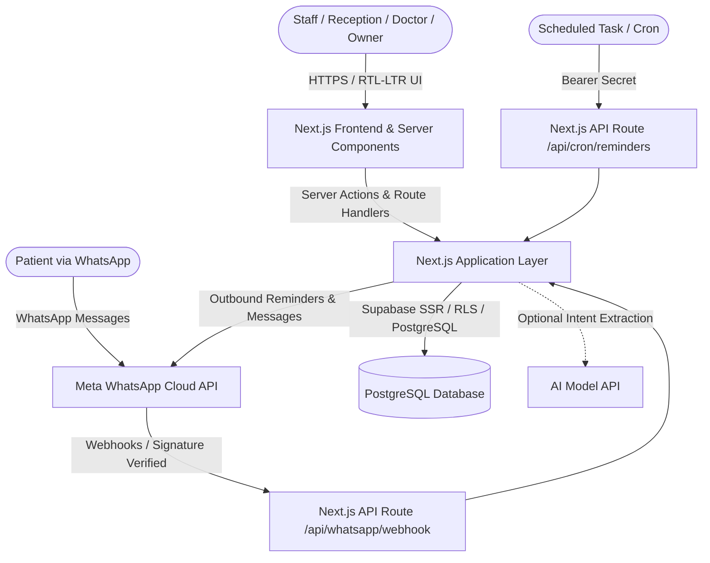

# MediFlow CRM — System Architecture

## 1. System Overview
MediFlow CRM is architected as a modular, monolithic full-stack application built with Next.js App Router and backed by PostgreSQL via Supabase.

---

## 2. Layered Structure
- **Presentation Layer (`src/app/`, `src/components/`):** React Server Components (RSC) and Client Components with Tailwind CSS and Radix UI primitives. Fully localized with direction-aware layout (RTL for Arabic, LTR for English).
- **Domain & Features Layer (`src/features/`):** Feature slices containing business logic, validation schemas (Zod), and domain services (patients, appointments, payments, whatsapp, bot).
- **Data Access & Server Layer (`src/server/`, `src/lib/`):** Supabase database client using the SSR package with Row Level Security.
- **External Integration Services:**
  - WhatsApp Cloud API client with mock mode toggle.
  - Background notification worker and scheduler.
  - Pluggable AI intent parsing adapter with deterministic fallback.

---

## 3. Security & Multi-Clinic Isolation Strategy
- Although Release 1 targets a single clinic workspace, all core data tables maintain a mandatory `clinic_id` foreign key.
- Row Level Security (RLS) policies on all tables verify that `auth.uid()` belongs to an active membership within the target `clinic_id`.
- Role-based permissions are enforced at the database level and replicated in server-side action validation.
